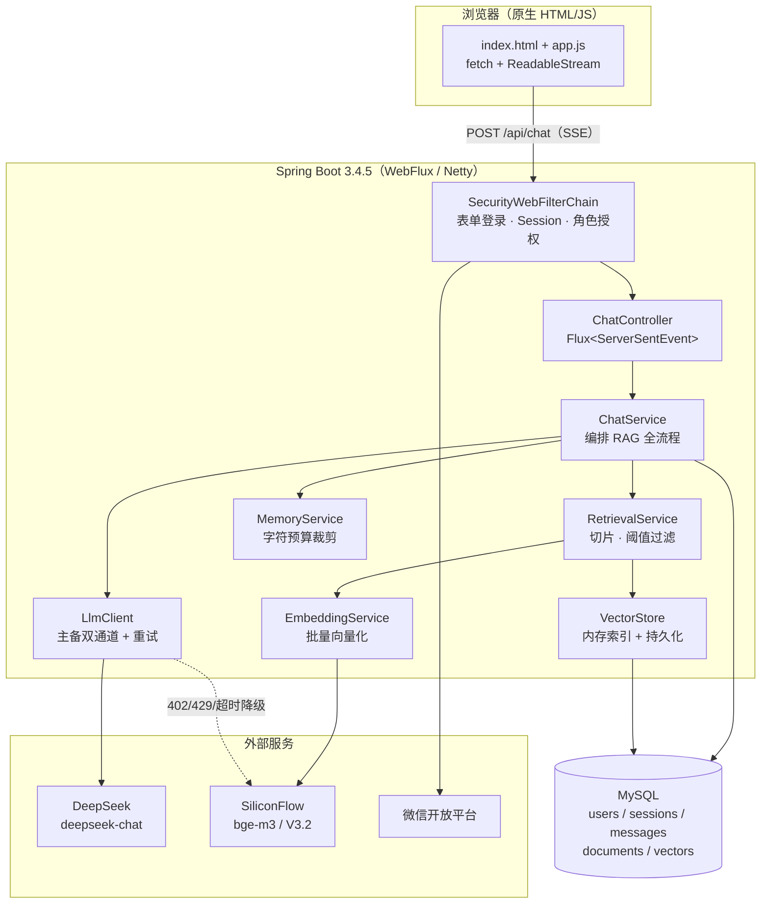

# 校园智答 · Campus Dialogue

> 面向高校场景的 **RAG 智能问答系统**：把规章制度、办事指南等校园资料向量化入库，用户提问时先检索、再由大模型**基于本校资料**作答，全程流式输出。

[](https://openjdk.org/)
[](https://spring.io/projects/spring-boot)
[](https://docs.spring.io/spring-framework/reference/web/webflux.html)
[](https://spring.io/projects/spring-security)
[](https://www.mysql.com/)
[](https://flywaydb.org/)

---

## 目录

- [一、项目简介](#一项目简介)
- [二、功能一览](#二功能一览)
- [三、技术栈](#三技术栈)
- [四、系统架构](#四系统架构)
- [五、目录结构](#五目录结构)
- [六、快速开始](#六快速开始)
- [七、配置说明](#七配置说明)
- [八、权限矩阵](#八权限矩阵)
- [九、接口一览](#九接口一览)
- [十、核心设计](#十核心设计)
- [十一、数据模型](#十一数据模型)
- [十二、测试](#十二测试)
- [十三、部署](#十三部署)
- [十四、常见问题](#十四常见问题)
- [十五、后续规划](#十五后续规划)

---

## 一、项目简介

高校信息天然分散：学籍怎么办、宿舍报修找谁、四六级什么时候报名、转专业什么条件——答案散落在几十份 PDF、通知和网页里。直接问大模型，它会**编**：编一个不存在的电话号码，编一个早已过期的截止日期。

本项目用一条完整的工程链路解决这个问题：

1. **建库** — 校园资料按 280 字滑窗切片（重叠 40 字），调用 `bge-m3` 生成 1024 维向量，落库并常驻内存；
2. **检索** — 用户提问同样向量化，与库中片段算余弦相似度，按阈值过滤后取 Top-K；
3. **生成** — 命中的片段拼进 system prompt，交给 DeepSeek 作答；没命中就明确说明，不硬凑；
4. **交互** — SSE 流式推字，前端逐字渲染，配合 Markdown、会话历史与知识库后台。

整体是一个 **Spring Boot 单体响应式应用**：WebFlux 承载并发流式请求，JPA 负责持久化，Flyway 管理表结构，Spring Security 负责全站登录与角色授权。

> 工程规模：**41 个 Java 源文件 / 约 3850 行后端代码 / 17 个前端文件 / 38 个单元测试**，
> 全部手写，无脚手架生成代码，适合作为课程设计、毕业设计或 Spring Boot 学习样本。

---

## 二、功能一览

| 模块 | 能力 |
|---|---|
| **智能问答** | 多轮对话 + SSE 流式输出（打字机效果）+ Markdown 渲染（已做 HTML 转义防 XSS） |
| **RAG 检索** | 余弦相似度 + **阈值过滤**噪声；未命中时降级为通用回答并明确提示 |
| **会话管理** | 新建 / 切换 / 历史查看 / 删除 / 删单条消息后重答；**按用户隔离，互不可见** |
| **上下文控制** | 按**字符预算**从最近消息向前裁剪，防超模型上下文窗口 |
| **登录方式** | 用户名登录 · **学号登录** · 微信扫码登录（三种任选，共用同一账号体系） |
| **账号体系** | 开放注册、表单登录、登出、ADMIN / USER 角色、个人中心（改用户名 / 改密码 / 绑定学号 / 绑定微信） |
| **知识库管理** | 运行时录入、上传 `.md/.txt`、单篇重建、全量重建、**清空知识库**、**导入示例库**、正文去重（仅 ADMIN） |
| **游客模式** | 未登录可浏览对话界面，提问时才引导登录，不打断浏览 |
| **微信扫码登录** | 完整 OAuth2 授权码链路（openid + unionid 双标识、`state` 防 CSRF）；未配置凭据自动降级为**演示模式** |
| **容灾降级** | LLM 主通道 402 欠费 / 429 限流 / DNS 失败 / 超时 → **自动切备用通道**，前端无感 |
| **并发保护** | 向量化批量并发 + LLM 流式调用**信号量限流**，避免触发模型服务 429 |

---

## 三、技术栈

### 后端

| 技术 | 版本 | 用途 |
|---|---|---|
| Spring Boot | 3.4.5 | 应用骨架、自动装配、配置绑定 |
| Spring WebFlux | 6.2.x | 响应式 Web 层（Netty），支撑 SSE 流式输出 |
| Spring Security | 6.4.x | 表单登录、Session 管理、路径级角色授权 |
| Spring Data JPA | 3.4.x | 实体映射与仓储（Hibernate 实现） |
| MySQL | 8.0+ | 业务数据 + 向量数据（JSON 数组存储） |
| Flyway | 11.3.0 | 数据库版本化迁移（`V1`~`V5`） |
| WebClient | Reactor Netty | 调用 DeepSeek / SiliconFlow / 微信开放平台 |
| JUnit 5 + Mockito | — | 单元测试 |

### 模型服务

| 能力 | 提供方 | 模型 |
|---|---|---|
| 对话生成 | DeepSeek（OpenAI 兼容） | `deepseek-chat`，`stream=true` |
| 备用对话 | SiliconFlow | `deepseek-ai/DeepSeek-V3.2` |
| 文本向量化 | SiliconFlow | `BAAI/bge-m3`（1024 维） |

### 前端

原生 **HTML + CSS + JavaScript**，无框架、无构建步骤。
流式部分用 `fetch` + `ReadableStream` 手动解析 SSE——因为 `EventSource` 不支持 POST，也不支持自定义请求头。

---

## 四、系统架构



**一次提问的完整链路：**

```
浏览器 POST /api/chat
  → SecurityWebFilterChain 校验 Session（未登录 401）
  → SessionService.getOrCreate(sessionId, 当前用户)   ← 会话强制归属，越权 404
  → MemoryService 按字符预算裁剪历史
  → RetrievalService.retrieve(question)
        ├─ EmbeddingService 调 bge-m3 → 1024 维查询向量
        ├─ VectorStore 全量算余弦相似度，取 Top-3
        └─ 低于阈值 0.3 的片段直接丢弃
  → 命中片段拼进 system prompt
  → LlmClient 流式调用 DeepSeek（失败自动切备用通道）
  → 边收边推 SSE：sources → token → done
  → 落库保存 user / assistant 两条消息
```

---

## 五、目录结构

```
campus-dialogue/
├── pom.xml
├── Dockerfile                      # 多阶段构建：maven 编译 → temurin JRE 运行
├── docker-compose.yml              # app + mysql 编排
├── db/init.sql                     # 容器首次初始化建库
├── src/main/java/com/campus/dialogue/
│   ├── CampusDialogueApplication.java
│   ├── config/                     # AppProperties（配置绑定）/ SecurityConfig / WebClientConfig
│   ├── controller/                 # 7 个 REST 控制器
│   ├── dto/                        # ChatRequest / ProfileDto
│   ├── entity/                     # 5 张表的 JPA 实体
│   ├── model/                      # ChatMessage / DocChunk / Message / Session
│   ├── repository/                 # 5 个 Spring Data 仓储
│   ├── security/                   # CampusUserDetailsService / CampusPasswordEncoder / Passwords
│   └── service/                    # 11 个服务（RAG / LLM / 账号 / 会话 / 向量库 …）
├── src/main/resources/
│   ├── application.yml             # 全部配置（支持环境变量覆盖）
│   ├── application-local.yml.example
│   ├── campus-docs/                # 10 篇示例校园资料（可手动导入）
│   ├── db/migration/               # Flyway：V1~V5
│   └── static/                     # 17 个前端文件，无构建步骤
│       ├── index.html / app.js     # 对话页
│       ├── login.html / login.js   # 登录（用户名 / 学号 / 微信）
│       ├── register.html           # 注册
│       ├── profile.html / .js      # 个人中心
│       ├── admin.html / .js        # 知识库 & 用户管理后台
│       └── styles.css / dialog.js  # 公共样式与确认弹窗
└── src/test/java/                  # 9 个测试类 / 38 个用例
```

---

## 六、快速开始

### 1. 环境要求

| 依赖 | 版本 |
|---|---|
| JDK | 17+（本地在 JDK 25 验证通过） |
| Maven | 3.9+ |
| MySQL | 8.0+（本地在 9.x 验证通过） |

### 2. 建库建账号

```sql
CREATE DATABASE IF NOT EXISTS campus_dialogue
  CHARACTER SET utf8mb4 COLLATE utf8mb4_unicode_ci;

CREATE USER IF NOT EXISTS 'campus_app'@'%' IDENTIFIED BY '你的密码';
GRANT ALL PRIVILEGES ON campus_dialogue.* TO 'campus_app'@'%';
FLUSH PRIVILEGES;
```

表结构不用手建：应用启动时 Flyway 会自动执行 `db/migration` 下的脚本。

### 3. 准备本地配置

```bash
cp src/main/resources/application-local.yml.example src/main/resources/application-local.yml
```

填三项即可跑起来：数据库密码、`LLM_API_KEY`（DeepSeek）、`EMBEDDING_API_KEY`（SiliconFlow，向量化用）。

> `application-local.yml` 已在 `.gitignore` 中，**真实密钥不进仓库**。生产用环境变量注入，见 [配置说明](#七配置说明)。

### 4. 启动

```bash
mvn -o spring-boot:run
```

或打包运行：

```bash
mvn -o clean package -DskipTests
java -jar target/campus-dialogue-1.0.0.jar
```

默认 **http://localhost:8080**。首次启动若 `users` 表为空，会用配置里的 `campus.auth.admin` 灌入一个管理员账号（默认 `admin` / `change_me`，**请立即改密**）。

### 5. 首次使用

1. 用管理员登录 → 自动进 `/admin.html`；
2. 知识库为空时点「**⬇ 导入示例库**」，10 篇校园资料会入库并建索引；
3. 回到对话页提问，例如「校园卡丢了怎么补办」；
4. 回答下方可展开「参考知识库」查看命中的资料原文；没命中则显示「未检索到相关资料（以下为通用回答）」。

---

## 七、配置说明

全部配置在 `application.yml`，括号内为可覆盖的环境变量。

### 数据库

| 配置项 | 默认值 | 说明 |
|---|---|---|
| `spring.datasource.url` | `jdbc:mysql://localhost:3306/campus_dialogue` | `${DB_URL}` |
| `spring.datasource.username` | `campus_app` | `${DB_USERNAME}` |
| `spring.datasource.password` | `change_me` | `${DB_PASSWORD}` |
| `spring.jpa.hibernate.ddl-auto` | `validate` | 表结构**只由 Flyway 管**，Hibernate 仅校验 |
| `spring.flyway.baseline-version` | `0` | 兼容早期由 Hibernate 预建过表的库 |

### 模型服务

| 配置项 | 默认值 | 说明 |
|---|---|---|
| `campus.llm.base-url` | `https://api.deepseek.com` | OpenAI 兼容地址，可换通义 / OpenAI |
| `campus.llm.api-key` | `${LLM_API_KEY}` | 主通道密钥 |
| `campus.llm.model` | `deepseek-chat` | |
| `campus.llm.max-concurrent` | `4` | 同时流式对话上限，超出排队，防 429 |
| `campus.llm.fallback.*` | SiliconFlow + V3.2 | 主通道 402/429/DNS 失败时的兜底 |
| `campus.embedding.*` | `BAAI/bge-m3` / 1024 维 | 也可指向本地 FlagEmbedding 起的 FastAPI |
| `campus.embedding.concurrency` | `4` | 大知识库重建时的向量化并发度 |

### RAG 与上下文

| 配置项 | 默认值 | 说明 |
|---|---|---|
| `campus.rag.top-k` | `3` | 每次注入 prompt 的片段数 |
| `campus.rag.similarity-threshold` | `0.3` | 余弦低于此值视为噪声，不注入 |
| `campus.rag.seed-on-empty` | `false` | **默认关闭**：删空知识库后重启不会复活示例文档 |
| `campus.memory.max-chars` | `4000` | 历史消息字符预算，超出从最旧的开始丢 |
| `campus.memory.window-size` | `10` | 兜底：最多保留最近 N 条 |

切片参数写死在 `RetrievalService`：`CHUNK_SIZE = 280`，`OVERLAP = 40`。

### 账号与微信

| 配置项 | 默认值 | 说明 |
|---|---|---|
| `campus.auth.admin.username` | `admin` | 仅当 `users` 表为空时作为种子写入 |
| `campus.auth.admin.password` | `change_me` | 同上，**生产必须改** |
| `campus.wechat.app-id` / `app-secret` | 空 | 留空则走演示模式 |
| `campus.wechat.redirect-uri` | `http://localhost:8088/profile.html` | 绑定微信回调，**需与实际端口一致** |
| `campus.wechat.login-redirect-uri` | `http://localhost:8088/login.html` | 扫码登录回调，同上 |

### Profile

| Profile | 作用 |
|---|---|
| `dev`（默认激活） | 静态资源直读 `src/main/resources/static`，前端改完刷新即生效；关闭 HTTP 缓存 |
| `local`（默认激活） | 读 `application-local.yml`，放本地私密值（已 gitignore） |
| `prod` | `local` 不生效，密钥全部由环境变量注入；静态资源从 jar 内读 |

默认 `spring.profiles.active: ${SPRING_PROFILE:dev,local}`，生产用 `SPRING_PROFILES_ACTIVE=prod` 覆盖。

---

## 八、权限矩阵

| 路径 | 匿名 | USER | ADMIN |
|---|:---:|:---:|:---:|
| `/login.html` `/register.html` `/styles.css` `/dialog.*` | ✅ | ✅ | ✅ |
| `/` `/index.html` `/app.js`（对话页外壳，游客可看） | ✅ | ✅ | ✅ |
| `/api/auth/login` `/api/auth/register` `/api/auth/logout` `/api/auth/wechat/**` | ✅ | ✅ | ✅ |
| `/api/auth/me` | ❌ 401 | ✅ | ✅ |
| `/profile.html` `/api/me/**` | ❌ | ✅ | ✅ |
| `/api/chat` `/api/sessions/**` `/api/docs/status` | ❌ 401 | ✅ | ✅ |
| `/admin.html` `/api/admin/**` `/api/docs/index\|reindex\|upload` | ❌ | ❌ 403 | ✅ |

规则在 `SecurityConfig.authorizeExchange` 中按顺序匹配，**顺序敏感**——`/api/auth/me` 必须写在 `/api/auth/**` 之前。

认证失败返回 JSON 401 / 403，页面请求则 302 回登录页。

---

## 九、接口一览

### 认证 `/api/auth`

| 方法 | 路径 | 说明 |
|---|---|---|
| POST | `/login` | 表单登录，`application/x-www-form-urlencoded`，字段 `username` / `password`。**username 可填用户名或已绑定学号** |
| POST | `/logout` | 登出，框架清 Session |
| GET | `/me` | 当前身份 `{username, role, studentNo}` |
| POST | `/register` | 开放注册 `{username, password}` |
| GET | `/wechat/authorize-url` | 取微信扫码地址（未配置则返回 `demo: true`） |
| POST | `/wechat/login` | 扫码回调 `{code, state}` |

> 登录成功返回 `{"username": "...", "role": "ADMIN|USER"}`，前端据此跳转。**返回的 username 永远是真实用户名**，即使本次是用学号登录的。

### 对话 `/api/chat`

| 方法 | 路径 | 说明 |
|---|---|---|
| POST | `/api/chat` | 请求 `{sessionId?, message, retry?}`，返回 `text/event-stream` |

响应头 `X-Session-Id` 携带会话 id。事件序列：`sources`（命中片段，始终发送）→ `token`（增量文本）→ `done`；出错时插入 `error`。

### 会话 `/api/sessions`

| 方法 | 路径 | 说明 |
|---|---|---|
| POST | `/api/sessions` | 新建会话 |
| GET | `/api/sessions` | 当前用户的会话列表 |
| GET | `/api/sessions/{id}/messages` | 会话消息（越权 404） |
| PATCH | `/api/sessions/{id}` | 重命名会话 `{title}` |
| DELETE | `/api/sessions/{id}` | 删除会话 |
| DELETE | `/api/sessions/{id}/messages?from={msgId}` | 删除某条及之后的消息（用于「重新回答」） |

### 个人中心 `/api/me`

| 方法 | 路径 | 说明 |
|---|---|---|
| GET | `/api/me` | 个人资料 |
| POST | `/api/me/username` | 改用户名 `{newUsername, password}` |
| POST | `/api/me/password` | 改密码 `{oldPassword, newPassword}` |
| PUT | `/api/me/student-no` | 绑定 / 解绑学号 `{studentNo}`，空值解绑 |
| GET | `/api/me/wechat/authorize-url` | 微信绑定授权地址 |
| POST | `/api/me/wechat/bind` | 微信绑定回调 |
| POST | `/api/me/wechat/unbind` | 解绑微信 |

### 知识库 `/api/docs`（ADMIN）

| 方法 | 路径 | 说明 |
|---|---|---|
| GET | `/api/docs/status` | `{documents, chunks, ragEnabled, ...}`（登录即可） |
| POST | `/api/docs/index` | 录入文本 `{text}` 并建索引 |
| POST | `/api/docs/reindex` | 全量重建索引 |
| POST | `/api/docs/upload` | 上传 `.md` / `.txt`（multipart，支持多文件） |

### 知识库管理 `/api/admin/docs`（ADMIN）

| 方法 | 路径 | 说明 |
|---|---|---|
| GET | `/api/admin/docs` | 文档列表 |
| GET | `/api/admin/docs/{id}` | 文档详情 |
| POST | `/api/admin/docs` | 新建（标题 + 正文），正文重复则覆盖已有文档 |
| PUT | `/api/admin/docs/{id}` | 修改并重新索引该篇 |
| DELETE | `/api/admin/docs/{id}` | 删除文档**及其向量片段**，不存在返回 404 |
| DELETE | `/api/admin/docs` | **清空知识库**（文档 + 片段全清） |
| POST | `/api/admin/docs/import-samples` | 导入 `campus-docs` 里的示例资料 |

### 用户管理 `/api/admin/users`（ADMIN）

| 方法 | 路径 | 说明 |
|---|---|---|
| GET | `/api/admin/users` | 用户列表 |
| POST | `/api/admin/users` | 创建账号 `{username, password, role}` |
| DELETE | `/api/admin/users/{id}` | 删除账号，**连带清理其会话与消息** |

---

## 十、核心设计

### 1. RAG 全链路

| 阶段 | 实现 |
|---|---|
| 切片 | `RetrievalService.split()`：280 字滑窗，重叠 40 字，保留跨段语义 |
| 向量化 | `EmbeddingService`：批量调用 `bge-m3`，`concurrency=4` 限流 |
| 存储 | `VectorStore`：内存 `CopyOnWriteArrayList` + `vectors` 表（JSON 数组），启动时全量载入 |
| 检索 | 全量余弦相似度 → `topK=3` → 丢弃 `< 0.3` 的片段 |
| 注入 | 命中片段拼进 system prompt 的 `【校园资料】` 块；一命中就要求「优先依据资料作答」 |
| 降级 | 检索或向量化失败（如校园网 DNS 抖动）→ 不注入资料，直接通用作答，对话不中断 |

**为什么用阈值而不是纯 Top-K**：Top-3 一定会返回 3 条，哪怕前 3 条都毫不相关。没有阈值，模型会拿着无关片段硬编答案——这是 RAG 最常见的幻觉来源。

### 2. 主备双通道

`LlmClient` 自己建 WebClient，不走全局配置：

```
主通道 DeepSeek → 402 欠费 / 429 限流 / 5xx / DNS 解析失败 / 建连超时
    ↓ 自动切换（对前端完全透明）
备用通道 SiliconFlow（DeepSeek-V3.2）
```

校园网 DNS（`dns.ncut.edu.cn`）偶发解析超时，因此建连超时设 10s 快速失败，不把整条链路挂死；同时关闭了 JDK 的负缓存，避免一次失败后长时间不可用。

### 3. 上下文预算

不按「条数」裁剪，按「字符预算」裁剪：从最新消息向前累加，超过 4000 字即停止，保证最后一条用户提问一定在内。按条数裁剪在长回答场景下会把上下文挤爆。

### 4. 会话隔离

`sessions` 表带 `username` 列，所有操作强制带用户条件：

```java
getOrCreate(id, username) / get(id, username) / delete(id, username) / rename(id, username, title)
```

越权访问统一返回 404（而不是 403，避免暴露「这个 id 存在但不属于你」）。

### 5. 认证与登录标识

完全使用 **Spring Security 6.4 原生体系**，没有任何自研过滤器或自签 token：

| 扩展点 | 作用 |
|---|---|
| `CampusUserDetailsService implements ReactiveUserDetailsService` | 查 `users` 表，`roles(role)` 自动补 `ROLE_` 前缀 |
| `CampusPasswordEncoder implements PasswordEncoder` | 复用 SHA-256 + 盐，保证存量账号能登录 |
| `UserDetailsRepositoryReactiveAuthenticationManager` | 响应式版 DaoAuthenticationProvider |

登录态存在服务端 WebSession（`WebSessionServerSecurityContextRepository`），Cookie 名 `SESSION`，空闲超时 8 小时。

**三种登录方式共用一个账号体系：**

```
用户名 ─┐
学号   ─┼→ CampusUserDetailsService.resolve() → UserDetails（getUsername() 恒为真实用户名）
微信   ─┘
```

学号登录的关键在于 **principal 里放的仍是真实用户名，不是学号**——因为会话归属、`@AuthenticationPrincipal(expression = "username")`、角色授权全都依赖它。学号只是「进门凭证」。

由于用户名和学号共用一个登录入口，写入侧做了**双向互斥**：

| 场景 | 结果 |
|---|---|
| 注册 / 改名的用户名 = 别人的学号 | 拒绝：「该用户名已被其他账号作为学号使用」 |
| 绑定学号 = 别人的用户名 | 拒绝：「该学号已被其他账号作为用户名使用」 |
| 绑定学号 = 别人的学号 | 拒绝：「该学号已被其他账号绑定」 |
| 自己的用户名当学号 | 放行（同一字符串仍指向自己） |

否则同一串字符指向两个账号，登录进谁家就说不清了。

### 6. 知识库一致性（三个踩过的坑）

| 坑 | 现象 | 现在的做法 |
|---|---|---|
| 删文档不删向量 | 文档没了，片段还在参与检索，回答仍是旧内容 | `delete()` 同事务清理 `doc_id` 对应的全部片段，并返回清理数量 |
| 删空后自动复活 | 知识库清空，重启又从 classpath 灌回 10 篇示例 | `campus.rag.seed-on-empty` 默认 `false`，需要示例资料手动「导入示例库」 |
| 僵尸片段 | 手动删库、历史遗留导致片段找不到归属文档 | `VectorStore.loadFromDb()` 启动时丢弃并删除 `doc_id` 无对应文档的片段 |

单篇保存 / 删除**即时更新索引**，不需要再点「重建索引」（全量重建只用于批量导入后修正）。

### 7. 前端两个容易踩的点

- **SSE 用 fetch 手解析**：`EventSource` 只支持 GET、不能带 body 和自定义头，所以用 `fetch` + `ReadableStream` 按 `\n\n` 分帧，逐条解析 `event:` / `data:`。
- **Markdown 先转义后渲染**：渲染前统一转义 `<` `>` `&`，再解析 Markdown 语法，避免模型输出里的 HTML 被浏览器执行。

---

## 十一、数据模型

| 表 | 关键字段 | 说明 |
|---|---|---|
| `users` | `username`(唯一) `password_hash` `role` `student_no`(唯一) `wechat_openid`(唯一) `wechat_unionid`(唯一) `wechat_nickname` `wechat_bound_at` | 学号与两个微信标识均可为空；密码为加盐哈希 |
| `sessions` | `id` `title` `username` `created_at` `updated_at` | 按 `username` 隔离 |
| `messages` | `id` `session_id` `role` `content` `ts` | `role ∈ {user, assistant}` |
| `documents` | `id` `title` `content` `source` `created_at` `updated_at` | `source` 形如 `manual` / `adhoc` / `upload:文件名` |
| `vectors` | `id` `doc_id` `text` `embedding` | `doc_id` 形如 `doc-12`；`embedding` 为 1024 维 JSON 数组 |

迁移脚本：

| 版本 | 内容 |
|---|---|
| `V1__init_schema.sql` | sessions / messages / documents / vectors |
| `V2__users.sql` | users 与角色 |
| `V3__user_profile.sql` | 学号、微信绑定字段 |
| `V4__sessions_username.sql` | 会话按用户隔离 |
| `V5__wechat_unionid_and_unique.sql` | unionid 及唯一索引 |

> 加字段 = 新增 `V6__xxx.sql`，**不要**把 `ddl-auto` 改回 `update`，否则 dev 与 prod 会出现 schema 漂移。

---

## 十二、测试

```bash
mvn -o test
```

**9 个测试类 / 38 个用例，全部通过。**

| 测试类 | 覆盖点 |
|---|---|
| `CampusUserDetailsServiceTest` | 角色前缀、学号登录取真实用户名、用户名优先、输入 trim、不存在抛异常 |
| `CampusPasswordEncoderTest` | 加盐哈希与校验（保证存量账号密码可用） |
| `UserLoginKeyTest` | 用户名与学号双向互斥、绑定学号成功 / 冲突、改名校验 |
| `SessionServiceTest` | 会话隔离、越权 404、消息删除、归属迁移 |
| `RetrievalServiceTest` | 切片、阈值过滤、空库降级 |
| `VectorStoreTest` | 向量增删、按文档清理 |
| `MemoryServiceTest` | 字符预算裁剪 |
| `UserServiceWechatTest` | unionid 优先、openid 兜底、重复绑定拒绝、解绑清理 |
| `WechatServiceTest` | state 一次性校验、错误码映射 |

JDK 17+ 下 Mockito 需要开放模块，`surefire` 已配好 `--add-opens`。JDK 25 下不要 mock 具体类，用 fake 子类或接口。

---

## 十三、部署

### 方式一：jar 直跑

```bash
mvn -o clean package -DskipTests
SPRING_PROFILES_ACTIVE=prod \
DB_URL='jdbc:mysql://db-host:3306/campus_dialogue?useUnicode=true&characterEncoding=UTF-8&connectionTimeZone=Asia/Shanghai' \
DB_USERNAME=campus_app DB_PASSWORD=*** \
LLM_API_KEY=*** EMBEDDING_API_KEY=*** \
AUTH_PASSWORD=*** \
java -jar target/campus-dialogue-1.0.0.jar --server.port=8080
```

### 方式二：Docker Compose

```bash
# 在项目根目录新建 .env（已在 .gitignore 中）
cat > .env <<'EOF'
LLM_API_KEY=你的 DeepSeek Key
EMBEDDING_API_KEY=你的 SiliconFlow Key
DB_PASSWORD=你的数据库密码
AUTH_PASSWORD=管理员初始密码
EOF
docker compose up -d
```

`app` 等 `mysql` 健康检查通过后再启动，以 `prod` profile 连接同网络内的 MySQL。建库脚本见 `db/init.sql`，表结构仍由 Flyway 迁移。

### 生产检查清单

- [ ] 改掉种子管理员密码 `AUTH_PASSWORD`
- [ ] 数据库账号只授权 `campus_dialogue.*`
- [ ] 开启 CSRF（当前为同源 Session Cookie，已关闭 CSRF 以便前后端分离调试）
- [ ] 微信回调地址与实际域名一致，且域名已备案（微信开放平台要求）
- [ ] 反代开启 HTTPS，`SESSION` Cookie 加 `Secure`

---

## 十四、常见问题

<details>
<summary><b>启动报错：表不存在 / Schema validation failed</b></summary>

Flyway 没跑成功。检查：数据库能否连通、账号是否有 DDL 权限、`db/migration` 是否在 classpath 里。
`ddl-auto: validate` 只校验不建表，表必须由 Flyway 建。
</details>

<details>
<summary><b>回答还是旧知识库的内容</b></summary>

按顺序排查：

1. **后台状态栏**是否显示「文档 N 篇 · 片段 M」，两者要对得上；
2. 是不是删的**磁盘上的 md 文件**？知识库存在 MySQL，删源文件不影响库；
3. **同一会话的历史消息会一起送给模型**。删库后若在原会话继续追问，模型会顺着上文旧答案说。**新建会话**再问。
</details>

<details>
<summary><b>回答总是「资料里没有」</b></summary>

阈值过滤把片段全丢了。可能原因：`similarity-threshold` 太高（先降到 0.2 试）、知识库确实没有相关内容、或者 `chunks` 为 0（没建索引）。
</details>

<details>
<summary><b>LLM 报 402 / 429 / 连不上</b></summary>

402 是余额不足，429 是限流。配置了 `campus.llm.fallback` 时会自动切备用通道，前端无感。
如果两条通道都失败，检查 API Key 与网络（校园网 DNS 偶发解析超时是已知问题）。
</details>

<details>
<summary><b>微信扫码登录 / 绑定不可用</b></summary>

未配置 `WECHAT_APP_ID` / `WECHAT_APP_SECRET` 时走**演示模式**：不访问微信服务器，派生一个演示 openid，流程可跑通但不对应真实微信。

真实接入需要微信开放平台「网站应用」，门槛是：**企业/组织主体 + 300 元认证费 + 已备案域名**（不接受 IP 和 localhost）。个人开发者无法开通。

`state` 校验失败常见原因：换了浏览器/无痕窗口、会话过期、回调域名与开放平台「授权回调域」不一致。
</details>

<details>
<summary><b>微信回调地址的端口对不上</b></summary>

`application.yml` 里 `redirect-uri` 默认写的是 `8088`，而 `server.port` 默认是 `8080`。
如果启动时改了端口，**必须同步改这两个回调地址**，否则微信会报 `redirect_uri 参数错误`。
</details>

<details>
<summary><b>前端改完不生效</b></summary>

`dev` profile 下静态资源直读 `src/main/resources/static`，刷新即可；有旧样式就 `Ctrl+Shift+R` 硬刷新。
打 jar 运行（`prod`）时从 jar 内读，必须重新打包。
**后端 Java 改动必须重启**，`spring-boot:run` 不热加载。
</details>

<details>
<summary><b>Windows 打包失败：文件被占用</b></summary>

正在运行的 jar 会锁住 `target` 下的文件。先停掉进程再 `mvn package`。
</details>

---

## 十五、后续规划

- **向量库** — 数据量上来后换 Chroma / Milvus / pgvector，避免全量内存计算
- **缓存与多实例** — Redis 存会话，配合 Spring Session 水平扩展
- **Function Calling** — 对接课表、成绩、报修等业务系统，从「问答」走到「办事」
- **文档解析** — 支持 PDF / Word / 网页抓取（引入 Tika 或版面解析组件）
- **可观测性** — Micrometer + Prometheus，监控检索命中率与 token 消耗
- **评测集** — 构造问答对，离线评估召回率与回答忠实度

---

## 说明

本项目为学习 / 教学用途的完整工程实践，代码与文档可自由参考。
**仓库内不含任何真实凭据**：数据库密码、模型 Key、种子管理员密码一律通过环境变量或本地私有配置注入。
