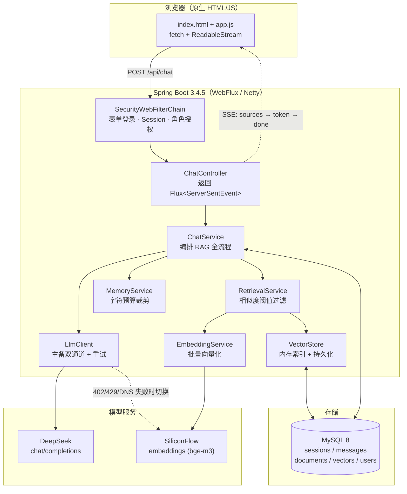

# 校园智答 · Campus Dialogue

> 面向高校校园场景的 **RAG 智能问答系统**：把校园规章制度、办事流程等资料向量化入库，
> 用户提问时先检索、再由大模型基于**本校资料**作答，全流程流式输出。

[](https://openjdk.org/)
[](https://spring.io/projects/spring-boot)
[](https://docs.spring.io/spring-framework/reference/web/webflux.html)
[](https://spring.io/projects/spring-security)
[](https://www.mysql.com/)
[](https://flywaydb.org/)

---

## 目录

- [一、项目简介](#一项目简介)
- [二、功能特性](#二功能特性)
- [三、技术栈](#三技术栈)
- [四、系统架构](#四系统架构)
- [五、目录结构](#五目录结构)
- [六、快速开始](#六快速开始)
- [七、配置说明](#七配置说明)
- [八、核心设计](#八核心设计)
- [九、接口文档](#九接口文档)
- [十、数据模型](#十数据模型)
- [十一、测试](#十一测试)
- [十二、部署](#十二部署)
- [十三、常见问题](#十三常见问题)
- [十四、扩展方向](#十四扩展方向)

---

## 一、项目简介

高校里的信息高度分散：学籍怎么办、宿舍报修找谁、四六级什么时候报名、转专业什么条件……
这些答案散落在几十份 PDF、通知和网页里。直接问大模型，它会**编**。

本项目用一个完整的工程闭环解决这个问题：

1. **建库**：把校园资料切分成片段，调用 `bge-m3` 生成 1024 维向量，落库；
2. **检索**：用户提问 → 同样向量化 → 与库中片段算余弦相似度 → 按阈值过滤，取 Top-K；
3. **生成**：把命中的片段拼进 prompt，交给 DeepSeek 生成回答，**没命中就明确说"资料里没有"**；
4. **交互**：SSE 流式推字，前端逐字渲染，配合 Markdown、会话历史、知识库后台。

整体是一个 **Spring Boot 单体的响应式应用**：WebFlux 处理并发流式请求，JPA 负责持久化，
Flyway 管理表结构，Spring Security 负责全站登录与角色授权。

> 工程规模：**40 个 Java 源文件 / 约 3200 行后端代码 / 17 个前端文件 / 20 个单元测试**，
> 全部手写，无脚手架生成代码，适合作为课程设计、毕业设计或 Spring Boot 学习样本。

---

## 二、功能特性

| 模块 | 能力 |
|---|---|
| **智能问答** | 多轮对话 + SSE 流式输出（打字机效果）+ Markdown 渲染（已做 HTML 转义防 XSS） |
| **RAG 检索** | 向量检索 + **余弦相似度阈值**过滤噪声；未命中时降级为通用回答并给出提示 |
| **会话管理** | 新建 / 切换 / 历史查看 / 删除 / 单条消息删除后重答；**按用户隔离，互不可见** |
| **上下文控制** | 按**字符预算**从最近消息向前裁剪，防止超出模型上下文窗口 |
| **知识库管理** | 运行时录入文本、上传 `.md/.txt` 批量入库、全量重建索引、文档级去重（仅 ADMIN） |
| **账号体系** | 开放注册、表单登录、登出、角色（ADMIN / USER）、个人中心（学号 / 微信绑定 / 改密） |
| **微信扫码登录** | 未绑定自动注册；未配置 app-id 时进入演示模式，便于本地联调 |
| **容灾降级** | LLM 主通道 402 欠费 / 429 限流 / DNS 失败 / 超时 → **自动切备用通道**，前端无感 |
| **并发保护** | 向量化批量并发 + LLM 流式调用**信号量限流**，避免触发模型服务 429 |

---

## 三、技术栈

### 后端

| 技术 | 版本 | 用途 |
|---|---|---|
| Spring Boot | 3.4.5 | 应用骨架、自动装配、配置绑定 |
| Spring WebFlux | 6.2.x | 响应式 Web 层（Netty），支撑 SSE 流式输出 |
| Spring Security | 6.4.x | 全站登录、Session 管理、角色授权 |
| Spring Data JPA | 3.4.x | 实体映射与仓储（Hibernate 实现） |
| MySQL | 8.0+ | 业务数据 + 向量数据（JSON 存储） |
| Flyway | 11.3.0 | 数据库版本化迁移（`V1~V4`） |
| WebClient | Reactor Netty | 调用 DeepSeek / SiliconFlow / 微信开放平台 |
| JUnit 5 + Mockito | - | 单元测试 |

### 模型服务

| 能力 | 提供方 | 模型 |
|---|---|---|
| 对话生成 | DeepSeek（OpenAI 兼容） | `deepseek-chat`，`stream=true` |
| 备用对话 | SiliconFlow | `deepseek-ai/DeepSeek-V3.2` |
| 文本向量化 | SiliconFlow | `BAAI/bge-m3`（1024 维） |

### 前端

原生 **HTML + CSS + JavaScript**，无框架、无构建步骤。
流式部分用 `fetch` + `ReadableStream` 手动解析 SSE（因为 `EventSource` 不支持 POST）。

---

## 四、系统架构



**一次提问的完整链路**（答辩时最常被问）：

```
浏览器 app.js ──POST /api/chat（带 SESSION Cookie）──▶ ChatController
  ① 校验登录态，取出当前用户与会话 ID（越权按 404 处理）
  ② 用户提问落库 messages
  ③ RetrievalService：提问 → bge-m3 向量 → 与 vectors 表逐条算余弦相似度 → 阈值 0.3 过滤 → Top-3
  ④ MemoryService：按 4000 字符预算从最近消息向前裁剪历史
  ⑤ 拼装 prompt：system 角色设定 + 【校园资料】片段 + 历史对话 + 本次提问
  ⑥ LlmClient：POST /chat/completions（stream=true），拿到 Flux<String>
  ⑦ ChatService 把 token 流包装成 SSE 事件：sources → token×N → done
  ⑧ 答复落库，更新会话 updated_at
```

---

## 五、目录结构

```
campus-dialogue/
├── pom.xml
├── Dockerfile
├── docker-compose.yml
├── db/init.sql                       # 容器首次启动建库
└── src
    ├── main/java/com/campus/dialogue
    │   ├── CampusDialogueApplication.java   # 启动类（关闭 DNS 负缓存 + 种子数据初始化）
    │   ├── config/
    │   │   ├── AppProperties.java           # @ConfigurationProperties 配置绑定
    │   │   ├── WebClientConfig.java         # 三个 WebClient（对话/向量化/微信），各自超时
    │   │   └── SecurityConfig.java          # Spring Security 全量配置
    │   ├── controller/
    │   │   ├── ChatController.java          # SSE 流式对话
    │   │   ├── SessionController.java       # 会话 CRUD
    │   │   ├── DocController.java           # 知识库：录入/上传/重建/状态
    │   │   ├── AuthController.java          # 注册/当前用户/微信登录
    │   │   ├── MeController.java            # 个人中心
    │   │   └── UserAdminController.java     # 用户管理（ADMIN）
    │   ├── service/
    │   │   ├── ChatService.java             # RAG 编排 + 错误文案 + 限流
    │   │   ├── LlmClient.java               # 主备双通道 LLM 调用
    │   │   ├── RetrievalService.java        # 向量检索 + 阈值
    │   │   ├── EmbeddingService.java        # 批量向量化
    │   │   ├── VectorStore.java             # 向量增删查 + 余弦相似度
    │   │   ├── MemoryService.java           # 上下文裁剪
    │   │   ├── SessionService.java          # 会话（按 username 隔离）
    │   │   ├── DocumentService.java         # 文档切分入库
    │   │   ├── UserService.java             # 账号 / 微信登录
    │   │   └── WechatService.java           # 微信开放平台
    │   ├── security/
    │   │   ├── CampusUserDetailsService.java  # ReactiveUserDetailsService 查库加载用户
    │   │   ├── CampusPasswordEncoder.java     # PasswordEncoder（SHA-256 + 盐）
    │   │   └── Passwords.java                 # 哈希工具
    │   ├── repository/                      # Spring Data JPA 仓储
    │   ├── entity/                          # Session / Message / Document / Vector / User
    │   ├── model/                           # 领域模型（LLM 消息、检索片段等）
    │   └── dto/                             # 请求/响应对象
    └── main/resources
        ├── application.yml                 # 主配置（占位符 + 环境变量）
        ├── application-local.yml.example   # 本地私密配置模板（真实文件不入库）
        ├── application-dev.yml             # 开发：打印 SQL、静态资源直读
        ├── application-prod.yml            # 生产：关闭 SQL 日志
        ├── db/migration/V1~V4              # Flyway 迁移脚本
        ├── campus-docs/                    # 首次启动自动入库的校园资料（10 篇）
        └── static/                         # 登录/对话/后台/个人中心页面
```

---

## 六、快速开始

### 1. 环境要求

- **JDK 17+**（本项目在 JDK 17 编译、JDK 25 运行验证通过）
- **Maven 3.8+**
- **MySQL 8.0+**

### 2. 建库建账号（只做一次）

```sql
CREATE DATABASE IF NOT EXISTS campus_dialogue
  DEFAULT CHARACTER SET utf8mb4 COLLATE utf8mb4_general_ci;

-- 应用专用账号：最小权限，只授权本项目库（Flyway 需要 DDL 权限）
CREATE USER IF NOT EXISTS 'campus_app'@'%' IDENTIFIED BY '你的强密码';
GRANT SELECT, INSERT, UPDATE, DELETE, CREATE, DROP, REFERENCES, INDEX, ALTER
  ON campus_dialogue.* TO 'campus_app'@'%';
FLUSH PRIVILEGES;
```

> 表结构不用手工建：首次启动时 **Flyway** 会自动执行 `db/migration/V1~V4`。

### 3. 配置密钥

项目**不提交任何真实密钥**。两种方式任选其一：

**方式 A（推荐，本地开发）**：复制模板并填值

```bash
cp src/main/resources/application-local.yml.example src/main/resources/application-local.yml
# 然后编辑 application-local.yml，填入数据库密码、DeepSeek Key、SiliconFlow Key
```

`application-local.yml` 已在 `.gitignore` 中，默认随 dev 一起激活，无需改启动命令。

**方式 B（推荐，容器/生产）**：用环境变量注入

```bash
# Linux / macOS
export DB_URL="jdbc:mysql://localhost:3306/campus_dialogue?useUnicode=true&characterEncoding=UTF-8&connectionTimeZone=Asia/Shanghai&useSSL=false&allowPublicKeyRetrieval=true"
export DB_USERNAME=campus_app
export DB_PASSWORD=你的强密码
export LLM_API_KEY=sk-xxx          # 对话：DeepSeek
export EMBEDDING_API_KEY=sk-xxx    # 向量化：SiliconFlow bge-m3
export AUTH_PASSWORD=你的管理员密码
```

```bat
:: Windows CMD
set DB_PASSWORD=你的强密码
set LLM_API_KEY=sk-xxx
set EMBEDDING_API_KEY=sk-xxx
```

> 配置优先级：命令行参数 > 环境变量 > `application-{profile}.yml` > `application.yml`。

### 4. 启动

```bash
# 开发模式（热重启 + 静态资源直读，改前端刷新即生效）
mvn spring-boot:run

# 或打包运行
mvn -DskipTests package
java -jar target/campus-dialogue-1.0.0.jar --server.port=8088
```

### 5. 访问

| 页面 | 地址 | 说明 |
|---|---|---|
| 智能对话 | http://localhost:8088/ | 未登录跳 `login.html` |
| 注册 | http://localhost:8088/register.html | 开放注册，默认 USER |
| 个人中心 | http://localhost:8088/profile.html | 学号 / 微信绑定 / 改密 |
| 知识库后台 | http://localhost:8088/admin.html | 仅 ADMIN |

默认端口是 `8080`，本地联调常用 `8088`（微信回调默认也配的 8088）。
默认种子管理员为 `admin`，密码由 `AUTH_PASSWORD` / `application-local.yml` 决定，**首次启动 `users` 表为空时**写入。

---

## 七、配置说明

### Profile 划分

| Profile | 用途 | 数据库 | 差异 |
|---|---|---|---|
| `dev` | 本地开发 | MySQL `campus_dialogue` | 打印 SQL、静态资源直读源码、DevTools 热重启 |
| `local` | 本地私密值 | 同上 | 只放密码和 Key，**文件不入库** |
| `prod` | 生产 | MySQL（`DB_URL` 可指向任意实例） | 关闭 SQL 日志、从 jar 内读静态资源 |

默认 `spring.profiles.active: dev,local`；生产用 `--spring.profiles.active=prod` 覆盖，
此时 `local` 不生效，所有密钥必须由环境变量提供。

**dev 与 prod 使用完全相同的 schema**（都由 Flyway 管理），因此不存在「本地能跑、上线就崩」的结构漂移问题。

### 关键配置项

```yaml
campus:
  llm:                        # 对话主通道（OpenAI 兼容）
    base-url: https://api.deepseek.com
    api-key: ${LLM_API_KEY:sk-xxxx}
    model: deepseek-chat
    temperature: 0.7
    max-tokens: 1024
    max-concurrent: 4         # 流式对话并发上限，超出排队，避免 429
    connect-timeout-seconds: 10
    response-timeout-seconds: 60
    fallback:                 # 备用通道（402 / 429 / DNS / 超时自动切换）
      enabled: true
      base-url: https://api.siliconflow.cn/v1
      api-key: ${LLM_FALLBACK_API_KEY:${EMBEDDING_API_KEY:sk-xxxx}}
      model: deepseek-ai/DeepSeek-V3.2

  embedding:                  # 向量化（OpenAI 兼容 /embeddings）
    base-url: https://api.siliconflow.cn
    api-key: ${EMBEDDING_API_KEY:sk-xxxx}
    model: BAAI/bge-m3
    dim: 1024
    concurrency: 4            # 大库重建时的向量化并发度

  rag:
    enabled: true
    top-k: 3
    similarity-threshold: 0.3 # 余弦相似度低于此值不注入 prompt

  memory:
    window-size: 10           # 兜底：最近消息条数上限
    max-chars: 4000           # 上下文字符预算（主策略）

server:
  reactive:
    session:
      timeout: 8h             # 登录态空闲超时
```

---

## 八、核心设计

### 1. RAG 检索链路

| 阶段 | 实现 | 关键点 |
|---|---|---|
| 切分 | `DocumentService` 按标题/段落/长度切块 | 保留标题作为上下文，避免片段断章取义 |
| 向量化 | `EmbeddingService` 调 bge-m3，`/embeddings` 批量提交 | `concurrency` 控制并发，避免打爆服务 |
| 存储 | `vectors` 表存 `chunk_text + embedding(JSON)` | 数据量小（教学场景）时省掉额外向量库依赖 |
| 检索 | 全量载入内存算余弦相似度 | 启动/新增文档时刷新内存索引 |
| 过滤 | `similarity >= 0.3` 才注入 prompt | 阈值是防幻觉的第一道闸门 |
| 降级 | 未命中则不拼资料，并在 `sources` 事件标注 `hasHit=false` | 前端展示"通用回答"提示 |

### 2. 会话按用户隔离

早期版本 `sessions` 表没有归属字段，导致所有登录用户能看到彼此的聊天记录。改造方案：

- `sessions` 表新增 `username` 列并建索引（`V4__sessions_username.sql`）；
- `SessionService` 的每个方法都必须带 `username` 参数：
  `create / list / get / getOrCreate / delete / rename / deleteMessagesFrom`；
- 仓储层用 `findByUsernameOrderByUpdatedAtDesc`、`findByIdAndUsername` 双重校验；
- 控制器通过 `@AuthenticationPrincipal(expression = "username")` 取当前用户；
- **越权访问统一返回 404**（而不是 403），不泄露"这条会话是否存在"。

### 3. 鉴权：Spring Security 原生体系

不自研过滤器、不自签 token，全部使用框架标准扩展点：

| 组件 | 角色 |
|---|---|
| `SecurityConfig` | `@EnableWebFluxSecurity` + `SecurityWebFilterChain`，集中声明路由授权 |
| `CampusUserDetailsService` | 实现 `ReactiveUserDetailsService`，查 `users` 表加载用户 |
| `CampusPasswordEncoder` | 实现 `PasswordEncoder`，复用项目原有的 SHA-256 + 随机盐算法（兼容存量账号） |
| `UserDetailsRepositoryReactiveAuthenticationManager` | 响应式版 `DaoAuthenticationProvider` |
| `WebSessionServerSecurityContextRepository` | 认证结果写入服务端 WebSession，Cookie 名 `SESSION`（HttpOnly） |

- **登录**：`POST /api/auth/login`，`application/x-www-form-urlencoded`，
  由框架 `FormLoginWebFilter` 接管（WebFlux 没有 `loginProcessingUrl()`，改用
  `requiresAuthenticationMatcher(pathMatchers(POST, "/api/auth/login"))`）；
  成功/失败由自定义 Handler 返回 JSON。
- **登出**：`POST /api/auth/logout`，由框架 `LogoutWebFilter` 销毁会话并清 Cookie。
- **授权**：`authorizeExchange` 按「公开 → 需登录 → 需 ADMIN」三段声明；
  接口未登录返回 `401` JSON，页面未登录 `302` 跳登录页；越权 `403`。
- **微信登录**：无密码，认证成功后手动把 `SecurityContext` 写入 WebSession，与表单登录等价。

> 踩坑记录：`authorizeExchange` 的匹配是**顺序敏感**的，`/api/auth/me` 的 `authenticated`
> 必须写在 `/api/auth/**` 的 `permitAll` **之前**，否则永远拿到 401。
> 另外 WebFlux 里 `ServerHttpResponse` 只 `setStatusCode` 不写 body 时状态码会被吞成 200，
> 必须显式 `writeWith` 一个空 `DataBuffer`。

### 4. LLM 主备双通道

校园网 DNS 不稳定，DeepSeek 也可能余额不足。`LlmClient` 的处理顺序：

```
请求主通道 → 402 余额不足 / 429 限流 / 连接超时 / DNS 解析失败
        ↓（记录 WARN 日志）
同一份 messages 立即改用备用通道重试
        ↓ 仍失败
返回结构化错误，ChatService 转成用户能看懂的中文提示
```

同时在启动类里把 JDK 的 DNS 负缓存关掉（`networkaddress.cache.negative.ttl=0`），
避免一次解析失败后被缓存住导致长时间不可用。

### 5. 上下文长度控制

不是简单地"只留最近 10 条"，而是**双策略**：

- `memory.max-chars`（主）：从最近一条往前累加字符数，超过 4000 就停 —— 控制 token 消耗；
- `memory.window-size`（兜底）：无论多短，最多 10 条 —— 防止极短消息把上下文拉得过长。

---

## 九、接口文档

> 除登录/注册外，所有接口都需要 `SESSION` Cookie；未登录返回 `401`。

### 对话

| 方法 | 路径 | 说明 |
|---|---|---|
| POST | `/api/chat` | 发送消息，SSE 流式返回 |

请求体：

```json
{ "sessionId": 12, "text": "转专业需要什么条件？", "retry": false }
```

SSE 事件序列：

```
event: sources   data: {"context":"...","hasHit":true,"count":2}
event: token     data: {"delta":"转专业"}
event: token     data: {"delta":"一般需要"}
...
event: error     data: {"message":"模型服务余额不足，请稍后再试"}   // 仅出错时
event: done      data: {"ok":true}
```

### 会话

| 方法 | 路径 | 说明 |
|---|---|---|
| POST | `/api/sessions` | 新建会话 |
| GET | `/api/sessions` | 当前用户的会话列表 |
| GET | `/api/sessions/{id}/messages` | 历史消息（越权 404） |
| DELETE | `/api/sessions/{id}` | 删除会话 |
| DELETE | `/api/sessions/{id}/messages?from={msgId}` | 删除该消息及其之后（改问重答） |

### 知识库（ADMIN）

| 方法 | 路径 | 说明 |
|---|---|---|
| POST | `/api/docs/index` | 录入资料文本并即时向量化 |
| POST | `/api/docs/upload` | 上传文件（`multipart/form-data`，key=`files`，`.md/.txt`） |
| POST | `/api/docs/reindex` | 全量重建向量索引 |
| GET | `/api/docs/status` | 知识库片段数量 |

### 认证与个人中心

| 方法 | 路径 | 说明 |
|---|---|---|
| POST | `/api/auth/login` | 表单登录（框架处理），返回 `{username, role}` + `SESSION` Cookie |
| POST | `/api/auth/register` | 开放注册（默认 USER） |
| GET | `/api/auth/me` | 当前用户与角色（401 = 未登录） |
| POST | `/api/auth/logout` | 登出（框架销毁会话） |
| GET | `/api/auth/wechat/authorize-url` | 微信扫码授权地址 |
| POST | `/api/auth/wechat/login` | 微信登录（已绑定则登录，否则自动注册） |
| GET / POST / DELETE | `/api/admin/users...` | 用户管理（ADMIN） |
| GET | `/api/me` | 个人资料 |
| PUT | `/api/me/student-no` | 绑定 / 解绑学号 |
| POST | `/api/me/password` | 修改密码 |
| GET | `/api/me/wechat/authorize-url` | 微信绑定授权地址 |
| POST | `/api/me/wechat/bind` · `/unbind` | 绑定 / 解绑微信 |

---

## 十、数据模型

| 表 | 关键列 | 说明 |
|---|---|---|
| `sessions` | `id, username, title, created_at, updated_at` | 会话（按 `username` 隔离） |
| `messages` | `id, session_id, role, content, ts` | 消息（用 `ts` 规避 MySQL 保留字 `TIMESTAMP`） |
| `documents` | `id, title, content, source, created_at, updated_at` | 知识库文档 |
| `vectors` | `id, doc_id, chunk_text, embedding` | 片段与向量（`chunk_text` 规避保留字 `TEXT`） |
| `users` | `id, username, password_hash, role, student_no, wechat_openid, ...` | 账号与个人资料 |
| `flyway_schema_history` | `version, description, success` | Flyway 迁移记录 |

**表结构统一由 Flyway 管理**：`V1__init_schema` → `V2__users` → `V3__user_profile` → `V4__sessions_username`。
Hibernate 只做 `ddl-auto: validate` 校验，**不自动建表/改表**。
新增字段的正确流程是「新增一个 `V5__xxx.sql`」，而不是把 `validate` 改回 `update`。

---

## 十一、测试

```bash
mvn test
```

JUnit 5 + Mockito，共 **20 个用例**：

| 测试类 | 覆盖点 |
|---|---|
| `VectorStoreTest` | 向量增删查、余弦相似度计算 |
| `RetrievalServiceTest` | Top-K 排序、阈值过滤、未命中降级 |
| `MemoryServiceTest` | 字符预算裁剪、窗口兜底 |
| `SessionServiceTest` | 会话按 username 隔离、越权 404、删除消息 |
| `CampusPasswordEncoderTest` | 哈希生成与校验、盐随机性 |
| `CampusUserDetailsServiceTest` | 用户加载、角色映射、不存在返回空 |

> JDK 17+ 下 Mockito inline 需要开放 `java.base` 模块，已在 `pom.xml` 的 surefire `argLine` 配好 `--add-opens`。
> JDK 25 下无法 mock 具体类，因此测试里用**手写 fake 子类**代替 `mock(具体类)`。

---

## 十二、部署

### 打包运行

```bash
mvn -DskipTests package
java -jar target/campus-dialogue-1.0.0.jar \
     --spring.profiles.active=prod \
     --server.port=8080
```

### Docker Compose

```bash
# 1) 准备 .env（不入库）
cat > .env <<'EOF'
MYSQL_ROOT_PASSWORD=强密码
DB_PASSWORD=强密码
LLM_API_KEY=sk-xxx
EMBEDDING_API_KEY=sk-xxx
AUTH_PASSWORD=管理员密码
EOF

# 2) 起
docker compose up -d
```

`docker-compose.yml` 会：MySQL 初始化 → 用 `MYSQL_USER/MYSQL_PASSWORD` 建最小权限账号 →
应用以 `prod` 启动并自动跑 Flyway 迁移。

### 生产检查清单

- [ ] `DB_PASSWORD` / `AUTH_PASSWORD` 用环境变量注入，别用默认值
- [ ] `LLM_API_KEY` / `EMBEDDING_API_KEY` 用环境变量注入
- [ ] 数据库账号只授权本项目库
- [ ] 对外 HTTPS（微信回调要求），并同步改 `WECHAT_REDIRECT_URI`
- [ ] 开启 CSRF（当前为同源 Session + 关闭 CSRF，生产建议恢复）
- [ ] 会话存储若要多实例，换成 Spring Session + Redis

---

## 十三、常见问题

<details>
<summary><b>启动报 <code>Schema-validation: missing table</code></b></summary>

表没建出来。检查 `spring.flyway.enabled=true` 且 `db/migration` 在 classpath 下；
若数据库是早期由 Hibernate 自动建表的，保留 `baseline-on-migrate: true` + `baseline-version: 0`。
</details>

<details>
<summary><b>聊天报「域名解析失败（DNS 超时）」</b></summary>

大概率不是 DNS 问题，而是模型服务返回了非 200（如 **402 余额不足**）被前端统一兜底成了网络错误。
打开日志看 `LlmClient` 的 WARN 行，确认主通道状态码；备用通道会自动接管。
</details>

<details>
<summary><b>回答总是「资料里没有相关内容」</b></summary>

检索阈值太高或知识库为空。先把 `campus.rag.similarity-threshold` 从 `0.3` 调到 `0.2` 试，
再确认 `GET /api/docs/status` 返回的片段数不为 0。
</details>

<details>
<summary><b>登录成功但刷新后又变未登录</b></summary>

`SESSION` Cookie 没带上。确认请求是**同源**访问（不要用 `127.0.0.1` 和 `localhost` 混着开），
并且 `server.reactive.session.timeout` 没有设得过短。
</details>

<details>
<summary><b>前端改完不生效</b></summary>

dev profile 下静态资源直读 `src/main/resources/static`，正常刷新即可；
若仍有旧样式，`Ctrl+Shift+R` 硬刷新。打 jar 运行（prod）时则是从 jar 内读，必须重新打包。
</details>

<details>
<summary><b>打包失败：文件被占用</b></summary>

Windows 下正在运行的 jar 会锁文件，先停掉进程再 `mvn package`。
</details>

---

## 十四、扩展方向

- **向量库**：数据量上来后换 Chroma / Milvus / pgvector，避免全量内存计算
- **缓存**：Redis 存会话与热点问答，配合 Spring Session 支持多实例
- **Function Calling**：对接课表、成绩、报修等业务系统，从"问答"走到"办事"
- **文档解析**：支持 PDF / Word / 网页抓取（引入 Tika 或版面解析组件）
- **可观测性**：接入 Micrometer + Prometheus，监控检索命中率与 token 消耗
- **评测**：构造问答集，离线评估召回率与回答忠实度

---

## 说明

本项目为学习/教学用途的完整工程实践，代码与文档均可自由参考。
密钥一律通过环境变量或本地私有配置文件注入，**仓库内不含任何真实凭据**。
